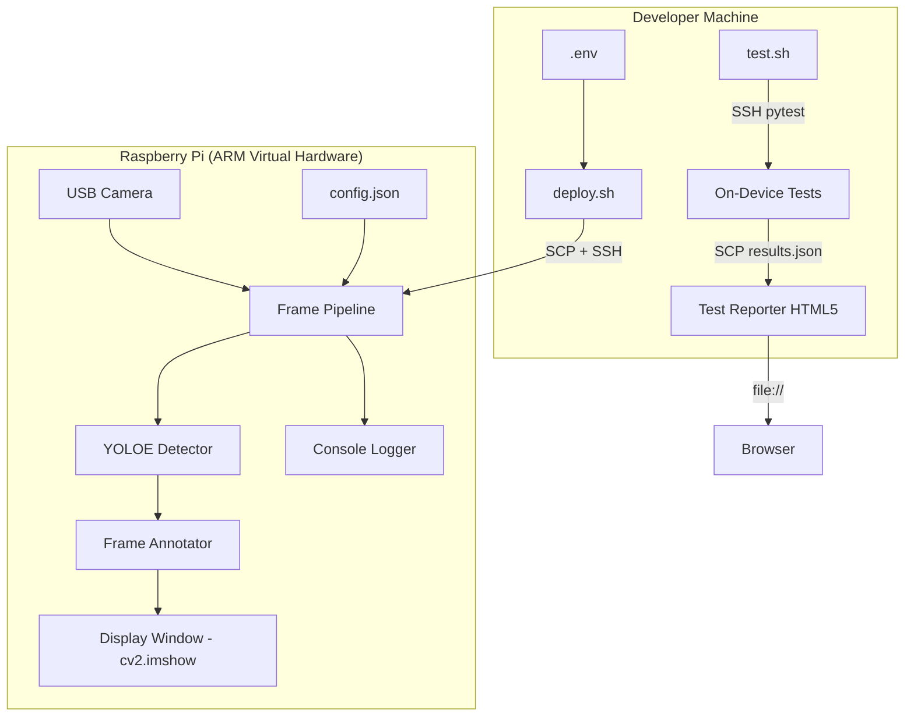

# Design Document: Pi Security Cam

## Overview

This system is a Python security camera application running on a virtualized Raspberry Pi 4 (ARM Virtual Hardware / Corellium backed by AWS Graviton). It uses YOLOE (YOLO with Embeddings) for text-prompted zero-shot object detection to identify a "knight in armor" in a live USB webcam feed. Detected knights are highlighted with bounding boxes and the target description is rendered as a text overlay on the video frame, displayed in a native OpenCV window (`cv2.imshow`) running directly on the Pi. The entire project is a cloneable GitHub repository with SSH-based deployment scripts. Tests run on-device and report results to a local HTML5 dashboard.

### Key Design Decisions

1. **YOLOE over two-stage detection**: A single YOLOE model handles both detection and classification via text prompt, eliminating the need for a separate classifier. The `yoloe-11s-seg.pt` (small) model balances accuracy and performance on ARM.

2. **Native OpenCV display (`cv2.imshow`) over Flask/MJPEG**: Using `cv2.imshow` for the display window is the lightest-weight approach — no extra dependencies beyond OpenCV (already required for capture and annotation), no web server overhead, and it's the standard pattern for OpenCV camera applications on the Pi. Keyboard input is handled natively via `cv2.waitKey`.

3. **pytest + JSON reporting**: Tests run on the Pi using pytest with `pytest-json-report` to produce machine-readable results. Results are SCP'd back to the dev machine and rendered by a static HTML5 page.

4. **Configuration via JSON + .env**: Application config (thresholds, prompts) lives in a JSON file. SSH credentials live in `.env` (gitignored) with a `.env.example` template.

## Architecture



### Data Flow

1. **Frame Capture**: OpenCV `VideoCapture` reads frames from the USB camera device
2. **Detection**: Each frame is passed to YOLOE with the configured text prompt
3. **Annotation**: Detections above the confidence threshold get bounding boxes drawn via OpenCV
4. **Display**: Annotated frames have the target description overlaid via `cv2.putText` and are shown in a native OpenCV window via `cv2.imshow`

## Components and Interfaces

### 1. Frame Pipeline (`pipeline.py`)

The main orchestrator that ties together camera capture, detection, annotation, and display.

```python
class FramePipeline:
    def __init__(self, config: AppConfig):
        """Initialize pipeline with configuration."""

    def start(self) -> None:
        """Start the camera capture, processing, and display loop."""

    def stop(self) -> None:
        """Stop the pipeline and release resources."""

    def _process_frame(self, frame: np.ndarray) -> np.ndarray:
        """Run detection and annotation on a single frame."""
```

The pipeline runs in the main thread (required by OpenCV's GUI). Each iteration: capture → detect → annotate → overlay target description → `cv2.imshow` → `cv2.waitKey`.

### 2. Detector (`detector.py`)

Wraps YOLOE inference with text-prompted detection.

```python
@dataclass
class Detection:
    bbox: tuple[int, int, int, int]  # x1, y1, x2, y2
    confidence: float
    label: str

class YOLOEDetector:
    def __init__(self, model_path: str, text_prompt: str, confidence_threshold: float = 0.3):
        """Load YOLOE model and configure text prompt."""

    def detect(self, frame: np.ndarray) -> list[Detection]:
        """Run inference on a frame and return detections above threshold."""

### 3. Frame Annotator (`annotator.py`)

Draws bounding boxes and labels on frames using OpenCV.

```python
class FrameAnnotator:
    BOX_COLOR = (0, 255, 0)  # Bright green in BGR
    FONT = cv2.FONT_HERSHEY_SIMPLEX

    def annotate(self, frame: np.ndarray, detections: list[Detection]) -> np.ndarray:
        """Draw bounding boxes and labels on the frame for each detection."""
```

### 4. Display Window (`display.py`)

Native OpenCV display module that shows annotated frames with a target description overlay.

```python
class DisplayWindow:
    WINDOW_TITLE = "Pi Security Cam"

    def __init__(self, target_description: str):
        """Create the named OpenCV window."""

    def show_frame(self, frame: np.ndarray) -> None:
        """Overlay target description text via cv2.putText and display via cv2.imshow."""

    def show_offline(self) -> None:
        """Display a black placeholder frame with 'Camera Offline' text."""

    def check_quit(self) -> bool:
        """Process cv2.waitKey and return True if 'q' was pressed."""

    def close(self) -> None:
        """Destroy the OpenCV window."""
```

The display window:
- Opens a native OpenCV window titled "Pi Security Cam" via `cv2.namedWindow`
- Renders the target description as a text overlay (e.g., "Looking for: Knight in Armor") on each frame via `cv2.putText`
- Handles keyboard input via `cv2.waitKey`, exiting when "q" is pressed
- Shows a black placeholder frame with "Camera Offline" text when no feed is available

### 5. Configuration (`config.py`)

Dataclass-based configuration with JSON serialization.

```python
@dataclass
class AppConfig:
    camera_device: int = 0
    confidence_threshold: float = 0.3
    target_description: str = "knight in armor"
    model_path: str = "yoloe-11s-seg.pt"

    @classmethod
    def from_json(cls, path: str) -> "AppConfig":
        """Load config from JSON file."""

    def to_json(self, path: str) -> None:
        """Save config to JSON file."""

    def to_dict(self) -> dict:
        """Convert to dictionary for serialization."""

    @classmethod
    def from_dict(cls, data: dict) -> "AppConfig":
        """Create from dictionary."""
```

### 6. Deployment Scripts

**`deploy.sh`** — Deploys the application to the Pi:
```bash
#!/bin/bash
# Loads .env for PI_HOST, PI_PASSWORD
# SCPs application files to pi@$PI_HOST:~/pi-security-cam/
# SSHs in to install dependencies (pip install -r requirements.txt)
# Starts the application as a background process
```

**`test.sh`** — Runs tests on the Pi and fetches results:
```bash
#!/bin/bash
# SSHs into the Pi
# Runs: pytest --json-report --json-report-file=results.json
# SCPs results.json back to local ./test-reporter/results.json
```

### 7. Test Reporter (`test-reporter/index.html`)

A single static HTML5 page that:
- Loads `results.json` via `fetch()` (served locally or opened as file)
- Renders a table of test results with name, status (pass/fail), duration
- Shows failure details in expandable rows
- Color-codes pass (green) / fail (red) status

## Data Models

### AppConfig

| Field | Type | Default | Description |
|-------|------|---------|-------------|
| camera_device | int | 0 | USB camera device index |
| confidence_threshold | float | 0.3 | Minimum detection confidence |
| target_description | str | "knight in armor" | Text prompt for YOLOE |
| model_path | str | "yoloe-11s-seg.pt" | Path to YOLOE model file |

### Detection

| Field | Type | Description |
|-------|------|-------------|
| bbox | tuple[int,int,int,int] | Bounding box coordinates (x1, y1, x2, y2) |
| confidence | float | Detection confidence score (0.0 - 1.0) |
| label | str | Detection label from the text prompt |

### Test Result (JSON schema from pytest-json-report)

| Field | Type | Description |
|-------|------|-------------|
| nodeid | str | Test identifier (e.g., "test_config.py::test_round_trip") |
| outcome | str | "passed", "failed", or "error" |
| duration | float | Test duration in seconds |
| longrepr | str | Failure details (empty if passed) |


## Correctness Properties

*A property is a characteristic or behavior that should hold true across all valid executions of a system — essentially, a formal statement about what the system should do. Properties serve as the bridge between human-readable specifications and machine-verifiable correctness guarantees.*

### Property 1: Confidence threshold filtering

*For any* list of Detection objects with varying confidence scores and *for any* confidence threshold value between 0.0 and 1.0, filtering the list should retain exactly those detections whose confidence is greater than or equal to the threshold and discard all others.

**Validates: Requirements 2.3**

### Property 2: Annotation completeness

*For any* valid video frame (numpy array of shape HxWx3) and *for any* non-empty list of Detection objects with valid bounding box coordinates within the frame dimensions, the annotated frame should differ from the original frame at pixels within or adjacent to each bounding box region, and the annotated frame should contain rendered text for each detection's label and confidence score.

**Validates: Requirements 3.1, 3.2**

### Property 3: No-detection passthrough

*For any* valid video frame, when the list of detections is empty, the annotated frame should be byte-identical to the input frame.

**Validates: Requirements 3.4**

### Property 4: Display window shows target description

*For any* non-empty target description string and *for any* valid video frame, rendering the target description overlay via `cv2.putText` should modify the frame such that the output frame differs from the input frame (text pixels are drawn onto the frame).

**Validates: Requirements 4.2**

### Property 5: Configuration round-trip

*For any* valid AppConfig object (with valid camera_device >= 0, 0.0 < confidence_threshold <= 1.0, non-empty target_description, and non-empty model_path), serializing to JSON and then deserializing back should produce an equivalent AppConfig object.

**Validates: Requirements 9.3**

### Property 6: Invalid configuration rejection

*For any* configuration dictionary containing at least one invalid value (negative camera_device, confidence_threshold outside (0, 1], empty target_description, or empty model_path), loading the configuration should raise a validation error.

**Validates: Requirements 5.4**

### Property 7: Test results parsing completeness

*For any* valid pytest JSON report containing one or more test entries, parsing the report should extract all test entries, and each parsed entry should contain the test name (nodeid), outcome status, and duration fields.

**Validates: Requirements 7.4, 7.5**

## Error Handling

| Error Condition | Component | Behavior |
|----------------|-----------|----------|
| Camera unavailable | Frame_Pipeline | Log error, retry every 5 seconds |
| Camera disconnects mid-stream | Frame_Pipeline | Log error, attempt reconnection, show "Camera Offline" placeholder in native display window |
| YOLOE model file not found | Detector | Log error, exit with non-zero status |
| YOLOE inference failure | Detector | Log error, skip frame, continue to next |
| Invalid config JSON | AppConfig | Log validation error, exit with non-zero status |
| Missing config file | AppConfig | Use default values for all parameters |
| SSH connection failure | deploy.sh | Print error message, exit with non-zero status |
| .env file missing | deploy.sh / test.sh | Print error message directing user to .env.example |

## Testing Strategy

### Dual Testing Approach

This project uses both unit tests and property-based tests for comprehensive coverage:

- **Unit tests**: Verify specific examples, edge cases, integration points, and error conditions
- **Property-based tests**: Verify universal properties across randomly generated inputs

### Testing Framework

- **pytest** as the test runner
- **Hypothesis** as the property-based testing library (Python's standard PBT library)
- **pytest-json-report** for machine-readable test output on the Pi

### Property-Based Test Configuration

- Minimum 100 iterations per property test (Hypothesis default `max_examples=100`)
- Each property test is annotated with a comment referencing the design property:
  ```python
  # Feature: pi-security-cam, Property 5: Configuration round-trip
  ```
- Tag format: **Feature: pi-security-cam, Property {number}: {property_text}**

### Test Organization

Tests live in a `tests/` directory alongside the application code:

```
tests/
├── test_config.py          # Config round-trip (Property 5), invalid config (Property 6)
├── test_detector.py        # Confidence filtering (Property 1)
├── test_annotator.py       # Annotation completeness (Property 2), no-detection passthrough (Property 3)
├── test_display.py         # Display window target description overlay (Property 4)
└── test_reporter.py        # Test results parsing (Property 7)
```

### On-Device Testing

Tests are designed to run on the Pi via SSH:
1. `test.sh` SSHs into the Pi and runs `pytest --json-report --json-report-file=results.json`
2. Results are SCP'd back to `test-reporter/results.json`
3. Opening `test-reporter/index.html` in a browser displays the results

Tests that require the YOLOE model or camera hardware are marked with `@pytest.mark.integration` and can be skipped in fast local runs.
